# API DevOps de Tarefas — CI/CD com GitHub Actions, ECR e EC2

**Aluno:** Gabriel Alencar · **Repositório:** <https://github.com/alencarrgabriel/devops-python-api>

**API publicada:** <http://184.192.235.28/health> · <http://184.192.235.28/docs>

## Descrição e objetivo

API REST de tarefas, escrita em Python com FastAPI, usada para demonstrar um fluxo completo de DevOps:

1. toda alteração é feita em uma **branch** e entra na `main` somente por **Pull Request**;
2. o PR só pode ser mergeado se a **integração contínua** (`ci.yml`) passar: análise estática, formatação, testes e teste do container;
3. cada merge na `main` dispara a **entrega contínua** (`deploy.yml`): testa de novo, gera a imagem Docker com a **tag igual ao SHA do commit**, publica no **Amazon ECR** e atualiza o container na **Amazon EC2**;
4. a versão em produção pode ser conferida pelo endpoint `/health`.

O fluxo foi validado com duas versões publicadas automaticamente: **1.0.0** (PR #1) e **1.1.0** (PR #2).

## Tecnologias utilizadas

| Camada | Ferramenta |
|---|---|
| Linguagem e framework | Python 3.13, FastAPI, Uvicorn |
| Qualidade e testes | pytest, pytest-cov, Ruff |
| Container | Docker (imagem `python:3.13-slim` com `HEALTHCHECK`) |
| CI/CD | GitHub Actions (`ci.yml` e `deploy.yml`), Rulesets do GitHub |
| Nuvem (AWS) | Amazon ECR (registry privado), Amazon EC2 (Amazon Linux 2023, t3.micro), Elastic IP, perfil de instância `LabInstanceProfile` (IAM Role `LabRole`), Security Group |

## Estrutura do repositório

```text
.
├── .github/workflows/
│   ├── ci.yml        # integração contínua: roda em todo PR para a main
│   └── deploy.yml    # entrega contínua: roda em todo push/merge na main
├── app/main.py       # API FastAPI
├── tests/test_api.py # testes automatizados
├── docs/evidencias/  # prints usados como evidência neste README
├── Dockerfile
├── compose.yaml
├── pyproject.toml    # configuração de pytest, cobertura e Ruff
├── requirements.txt
└── requirements-dev.txt
```

## Endpoints

| Método | Caminho | Objetivo | Resposta |
|---|---|---|---|
| GET | `/` | Apresentar a API | `200` |
| GET | `/health` | Saúde e **versão** implantada | `200` |
| GET | `/tasks` | Listar tarefas | `200` |
| POST | `/tasks` | Criar tarefa | `201` |
| PATCH | `/tasks/{id}/done` | Concluir tarefa | `200` ou `404` |

## Execução local

Pré-requisitos: Git e Python 3.13 ou superior.

```powershell
git clone https://github.com/alencarrgabriel/devops-python-api.git
cd devops-python-api
python -m venv .venv
.venv\Scripts\Activate.ps1          # Linux/macOS: source .venv/bin/activate
python -m pip install --requirement requirements-dev.txt

# as mesmas verificações da CI
ruff check .
ruff format --check .
pytest --cov=app --cov-report=term-missing

# subir a API
uvicorn app.main:app --reload       # http://localhost:8000/docs
```

## Docker: build e execução

```bash
docker build -t devops-python-api:local .
docker run -d --name devops-python-api -p 8000:8000 devops-python-api:local
docker ps                            # STATUS deve mostrar (healthy)
curl http://localhost:8000/health    # {"status":"ok","version":"1.1.0"}
docker rm -f devops-python-api
```

O `Dockerfile` usa a imagem `python:3.13-slim`, roda com usuário sem privilégios e declara um `HEALTHCHECK` que consulta `/health`.

## Pipeline de integração contínua (`ci.yml`)

Dispara em `pull_request` para a `main`, em `push` na `main` e manualmente.

| Job | Passos |
|---|---|
| **Qualidade e testes** | checkout → Python 3.13 (com cache do pip) → instala dependências → `ruff check` → `ruff format --check` → `pytest` com cobertura → publica `coverage.xml` e `junit.xml` como artefato |
| **Build e teste do container** | só roda se o job anterior passar → `docker build` → `docker run` → espera `/health` responder → mostra os logs → remove o container |

**Proteção da `main`:** um *ruleset* exige Pull Request e torna os dois jobs acima **status checks obrigatórios**. Sem CI verde, o botão de merge fica bloqueado.

## Pipeline de entrega contínua (`deploy.yml`)

Dispara em todo `push` na `main` (ou seja, em todo merge de PR) e manualmente. Usa `concurrency` para nunca rodar dois deploys ao mesmo tempo.

| Job | O que faz |
|---|---|
| **1. Testes automatizados** | Roda o `pytest` de novo sobre o código exato da `main`. |
| **2. Build e publicação no ECR** | Autentica na AWS com os secrets, faz login no ECR, `docker build` e `docker push` com a tag `${{ github.sha }}`. |
| **3. Deploy na EC2** | Por SSH, na EC2: `docker login` no ECR **usando a IAM Role da instância** → `docker pull` da imagem do commit → remove o container antigo → `docker run -p 80:8000 --restart unless-stopped` → limpa imagens antigas. Depois confere se o container está `running` e se `http://<IP>/health` responde. |

Cada job depende do anterior (`needs`): se os testes falharem, nada é publicado.

### Secrets e variables

| Tipo | Nome | Uso |
|---|---|---|
| Secret | `AWS_ACCESS_KEY_ID`, `AWS_SECRET_ACCESS_KEY`, `AWS_SESSION_TOKEN` | Credenciais temporárias do AWS Academy, usadas pelo runner para enviar a imagem ao ECR |
| Secret | `EC2_HOST`, `EC2_USER`, `EC2_SSH_KEY` | Acesso SSH à instância |
| Variable | `AWS_REGION` = `us-east-1` | Região |
| Variable | `ECR_REPOSITORY` = `devops-python-api` | Nome do repositório no ECR |

Nenhuma credencial fica no código: os valores dos secrets são criptografados pelo GitHub e mascarados nos logs.

## Arquitetura de implantação

```text
 Desenvolvedor
     │ git push (branch)
     ▼
 Pull Request ──► ci.yml ── ruff + pytest + build/teste do container
     │               (status checks obrigatórios pelo ruleset)
     │ merge
     ▼
 main ──► deploy.yml
            ├─ 1. pytest
            ├─ 2. docker build + push ─────────► Amazon ECR
            │       tag = SHA do commit            (repositório privado)
            └─ 3. SSH na EC2                              ▲
                    ├─ docker login (IAM Role) ───────────┘
                    ├─ docker pull <imagem:SHA>
                    └─ docker run  -p 80:8000
                              │
                              ▼
          Amazon EC2 (Amazon Linux 2023 · Elastic IP 184.192.235.28)
          Security Group: 22 (SSH) e 80 (HTTP)
                              │
                              ▼
          http://184.192.235.28/health → {"status":"ok","version":"1.1.0"}
```

## Endereço da API publicada

- Saúde e versão: <http://184.192.235.28/health>
- Documentação Swagger: <http://184.192.235.28/docs>

> A instância roda no AWS Academy Learner Lab, por isso a API só responde enquanto o laboratório está ativo.

## Como verificar a versão implantada

- `curl http://184.192.235.28/health` → campo `version`.
- Na EC2: `docker ps` → a tag da imagem é o SHA do commit da `main`.
- No ECR: a tag mais recente é o SHA do último merge na `main`.
- Em **Actions → Deploy EC2**, o resumo do job de publicação mostra a imagem enviada.

## Pull Requests

| PR | Branch | Conteúdo | Versão publicada |
|---|---|---|---|
| [#1](https://github.com/alencarrgabriel/devops-python-api/pull/1) | `feature/ci-cd-ec2` | Corrige a CI, remove o workflow de ECS não utilizado e cria o `deploy.yml` | 1.0.0 (commit `fa72355`) |
| [#2](https://github.com/alencarrgabriel/devops-python-api/pull/2) | `feature/versao-1-1-0` | Atualiza a API e os testes para a versão 1.1.0 | 1.1.0 (commit `c5aed51`) |

## Evidências

### Infraestrutura AWS e configuração do GitHub

**Instância EC2 em execução, com 3/3 verificações aprovadas**
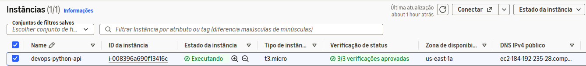

**IAM Role da instância (`LabRole`) e Security Group com as portas 22 (SSH) e 80 (HTTP) liberadas**
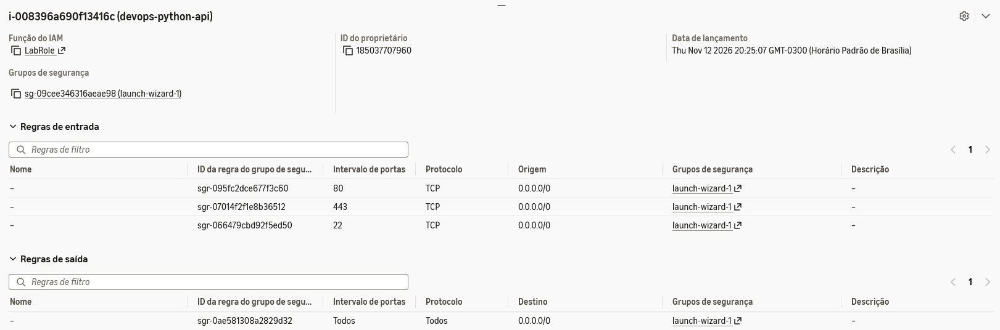

**EC2 com Docker instalado e acesso ao ECR pela IAM Role**
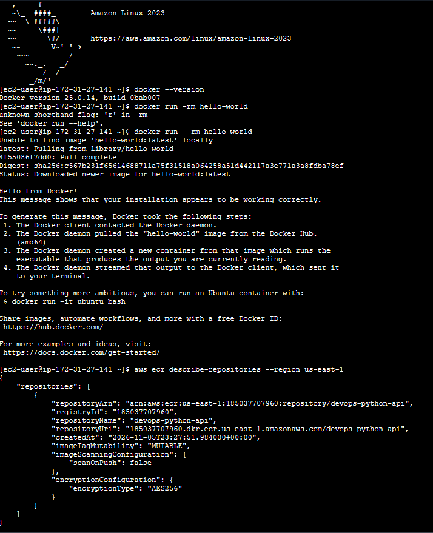

**Secrets do repositório (somente os nomes)**
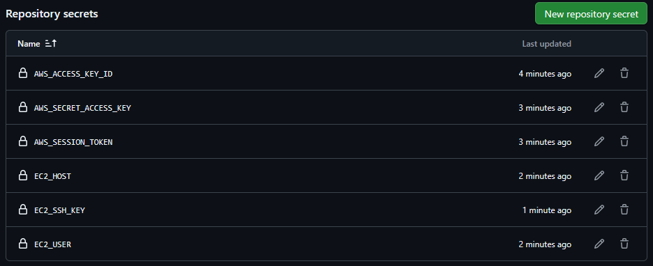

**Variables do repositório**
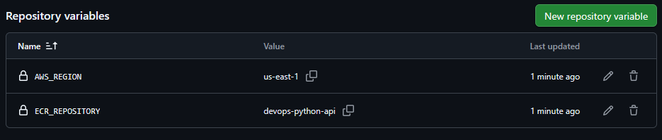

**Ruleset da `main`: Pull Request obrigatório e os dois jobs da CI como status checks obrigatórios**
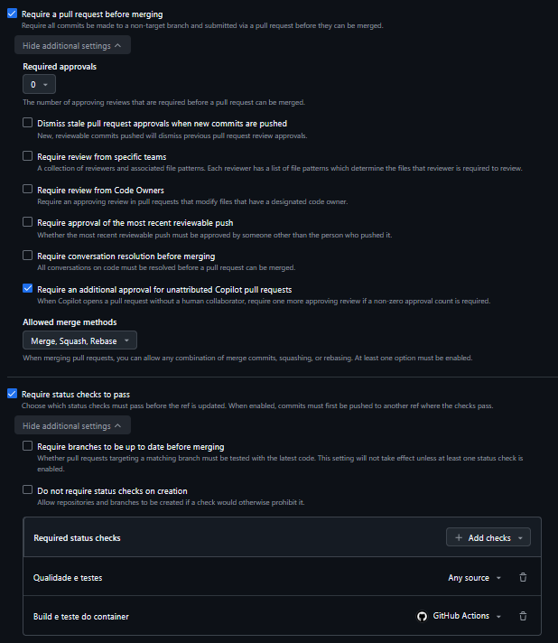

### Desenvolvimento local

**Testes passando localmente**
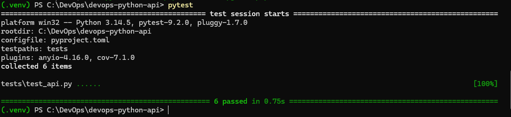

**Container local em execução com status `(healthy)`**
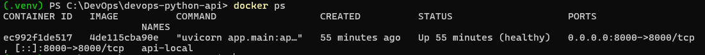

**`/health` respondendo no container local**
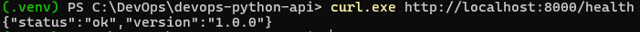

**Swagger da API rodando localmente**
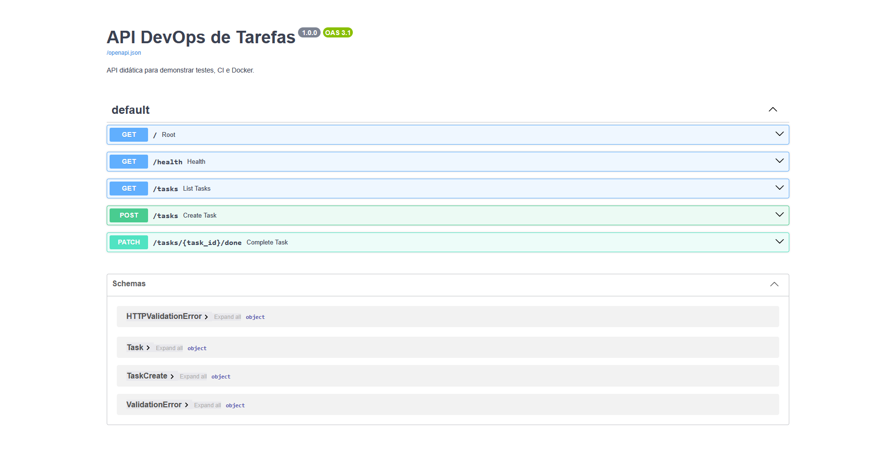

**Commit do `deploy.yml` na branch `feature/ci-cd-ec2`**
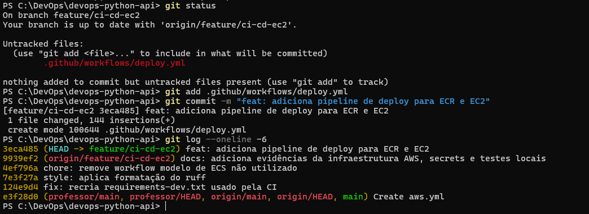

### Ponto de partida: pipelines falhando na `main`

Antes das correções, a `main` tinha a CI quebrada (faltava o `requirements-dev.txt`) e um workflow modelo de ECS com valores de exemplo. Os dois problemas foram corrigidos no PR #1.

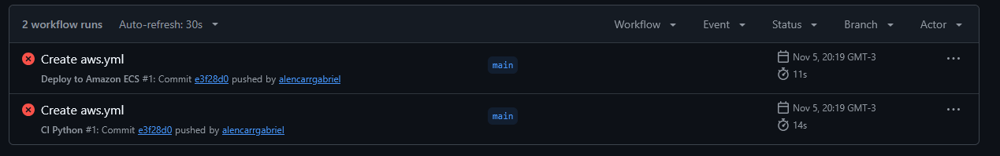
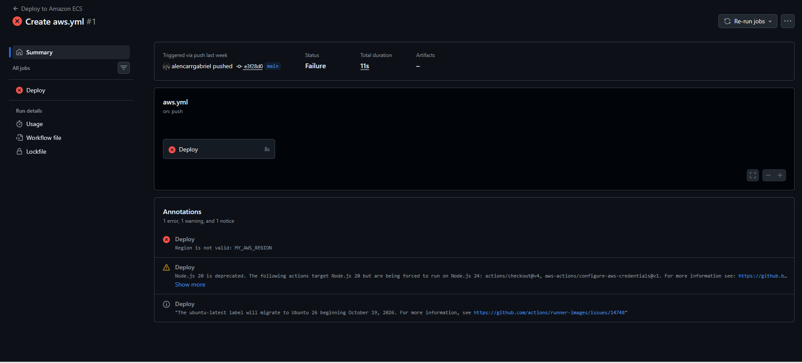

### PR #1 e integração contínua

**PR #1 com os status checks obrigatórios do ruleset**
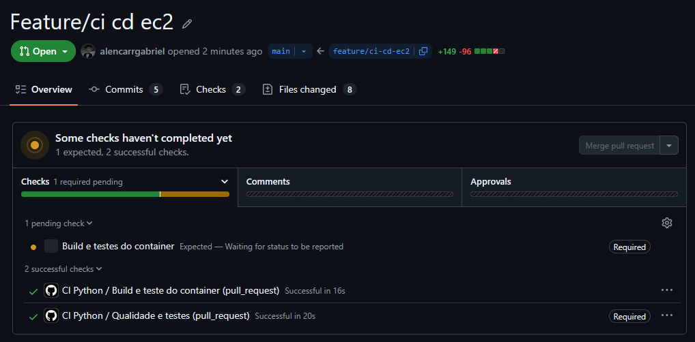

**Job "Qualidade e testes" no PR**
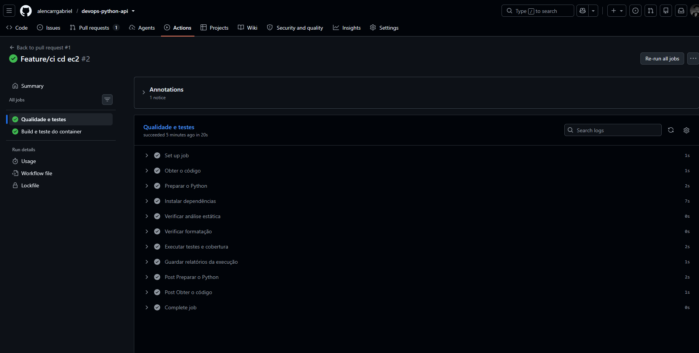

**Passo "Executar testes e cobertura": 6 testes passando e cobertura de 94% (mínimo exigido: 90%)**
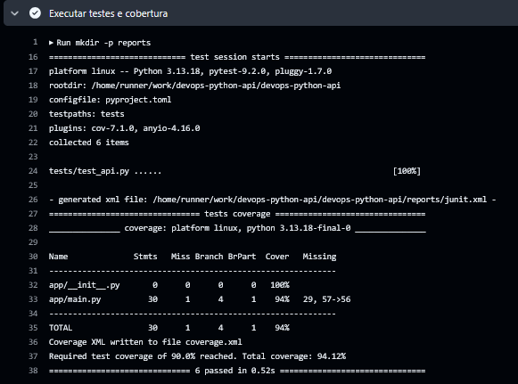

**Job "Build e teste do container" no PR**
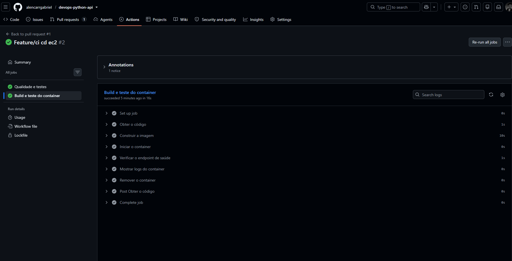

**PR #1 mergeado na `main`**
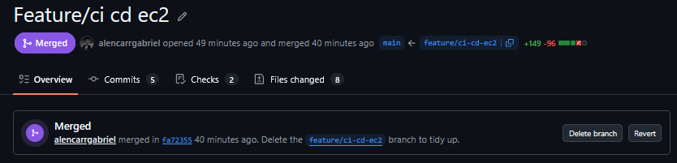

**CI na `main` após o merge do PR #1**
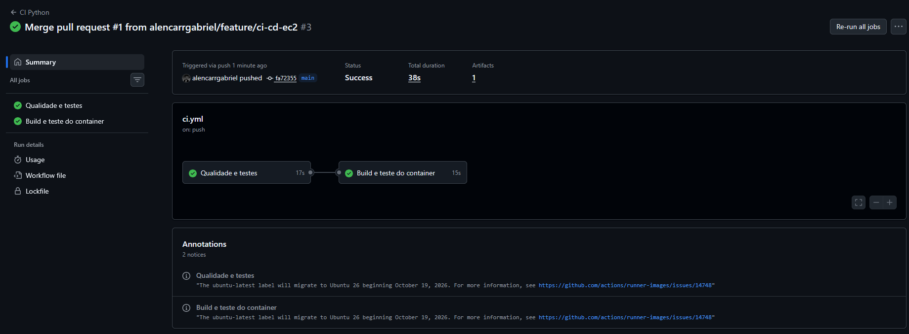

### Versão 1.0.0: primeiro deploy

**Deploy EC2 com os 3 jobs concluídos**
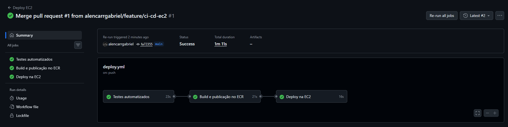

**Passo "Atualizar o container na EC2": login no ECR pela IAM Role, pull da imagem com a tag do commit, troca do container e limpeza das imagens antigas**
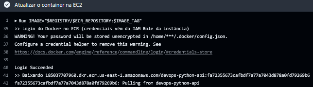
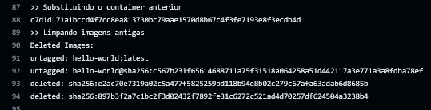

**Verificações finais do deploy: container em execução e API respondendo**
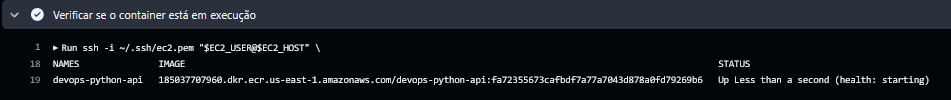
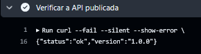

**Container na EC2 rodando a imagem do ECR com a tag = SHA `fa72355…`**
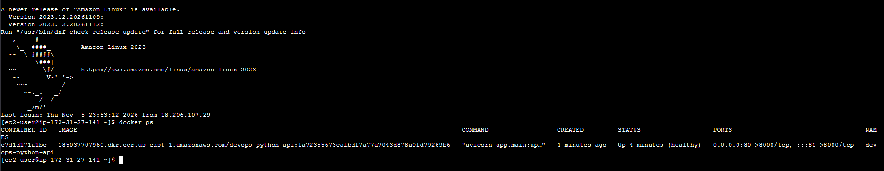

**`/health` respondendo a versão 1.0.0**
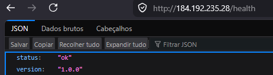

**Swagger publicado na EC2**
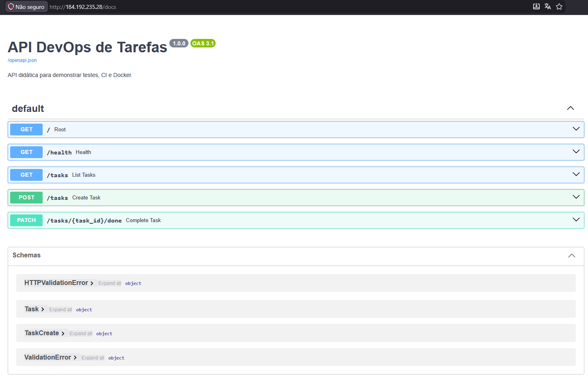

### Versão 1.1.0: atualização automática

**Testes locais passando com a versão 1.1.0**
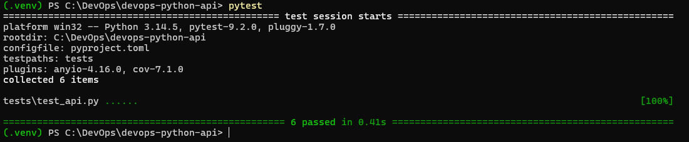

**PR #2 com os status checks aprovados**
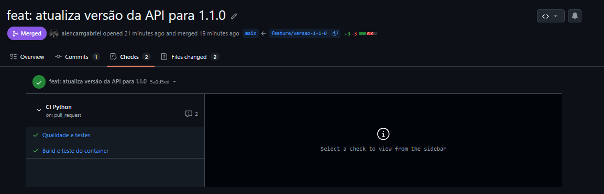

**PR #2 mergeado na `main`**
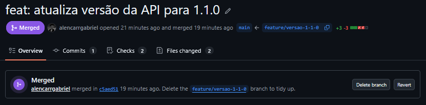

**Segundo Deploy EC2, disparado pelo merge do PR #2: imagem com tag `c5aed51…` publicada no ECR**
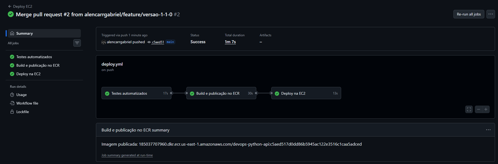

**Container na EC2 substituído automaticamente pela imagem nova (tag `c5aed51…`)**
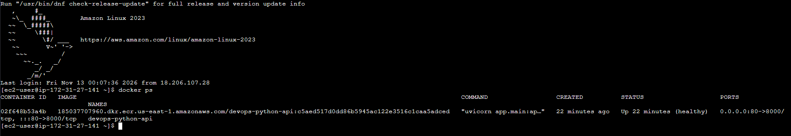

**`/health` respondendo a versão 1.1.0, no mesmo endereço**
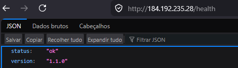
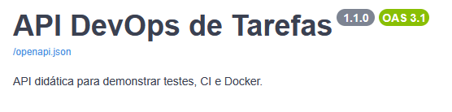

## Problemas encontrados e soluções

| Problema | Causa | Solução |
|---|---|---|
| CI falhando na `main` | `requirements-dev.txt` ausente | Arquivo recriado no PR #1 |
| Workflow "Deploy to Amazon ECS" falhando com `Region is not valid: MY_AWS_REGION` | Modelo de ECS do GitHub com valores de exemplo; o trabalho usa EC2 | Workflow removido no PR #1 |
| PR com check obrigatório pendente para sempre | Nome do check digitado errado no ruleset | Check selecionado pela lista de sugestões do GitHub, com o nome exato do job |
| Primeiro Deploy EC2 falhando com `The security token included in the request is invalid` | As credenciais do AWS Academy expiram a cada sessão do laboratório | Secrets `AWS_*` atualizados e "Re-run failed jobs" |
